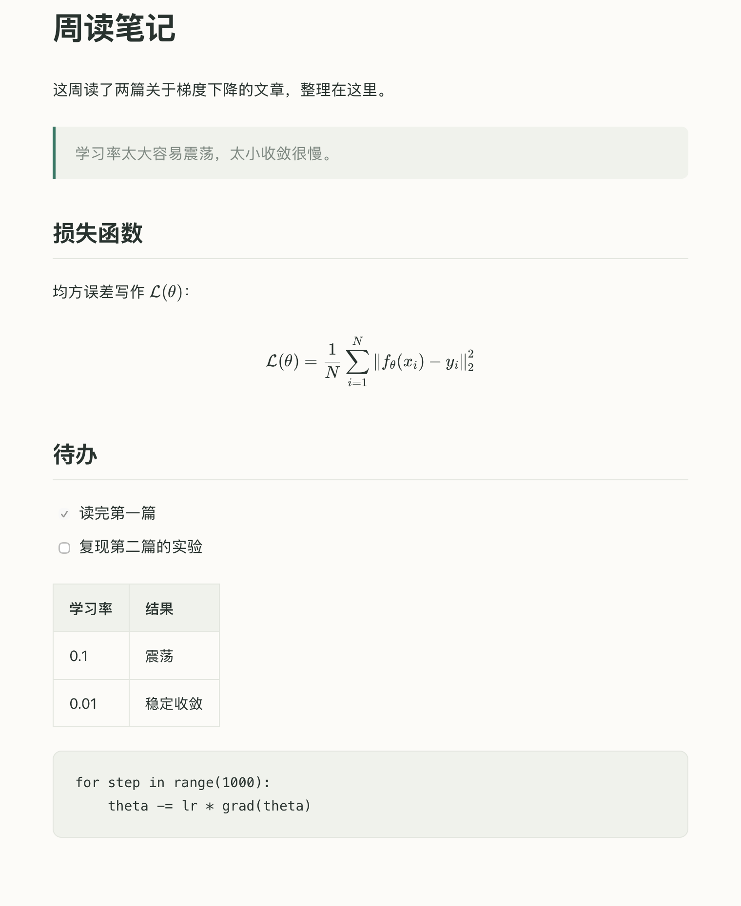
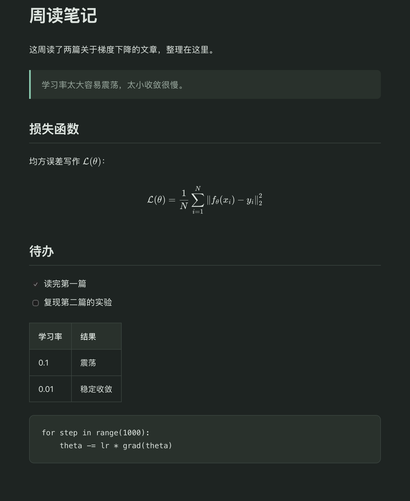

  

<h1 align="center">叶子 · Leaf</h1>

  一个 macOS 上的 Markdown 阅读器，打开就能读，需要时切换到纯文本编辑。 
  原本是我自己用的小工具，免费分享出来。

  <a href="https://github.com/chenxin-dlut/Leaf/releases/latest"><b>下载 Leaf.dmg</b></a>
  · macOS 13+ · Apple 芯片 · 约 1.4 MB

  
  

## 功能

- 阅读视图跟随系统的浅色 / 深色外观
- 支持表格、任务列表、代码块、相对路径图片和 KaTeX 数学公式，中文排版正常
- 一个窗口里打开多个文档，在左侧列表中切换
- 编辑后自动保存；文件被其他程序修改后自动重新载入
- 原生 AppKit 应用，渲染所需的脚本和字体都打包在应用内，不需要联网

功能不多，适合只想快速看一眼、顺手改几个字的场景。暂不支持 Obsidian 专用语法和 Mermaid 图表。

## 安装

要求：Apple 芯片（M 系列）的 Mac，macOS 13 或更新。

1. 在 [Releases](https://github.com/chenxin-dlut/Leaf/releases/latest) 页面下载 `Leaf.dmg`。
2. 打开 DMG，把 `Leaf.app` 拖到 `Applications`（应用程序）文件夹。
3. 第一次打开时，macOS 会提示无法验证开发者，这是因为应用没有经过 Apple 公证：
   - macOS 15 及更新：先双击打开一次，看到提示后点“完成”；然后打开“系统设置 → 隐私与安全性”，在页面下方找到 Leaf，点“仍要打开”。
   - macOS 13–14：在“应用程序”里右键点 Leaf，选“打开”，再点“打开”。

   之后就可以正常双击打开了。也可以在终端执行 `xattr -dr com.apple.quarantine /Applications/Leaf.app` 解除限制。

想让 Finder 双击 `.md` 文件时用叶子打开：选中一个 `.md` 文件，按 ⌘I，在“打开方式”中选 Leaf，然后点“全部更改”。

## 使用

按 ⌘O 选择 Markdown 文件，或把文件拖进窗口。

所有文档都在同一个窗口中打开，点击左侧列表切换；悬停在列表项上可点 × 关闭，未保存的文档在列表中显示圆点。点击窗口顶部的文件名，或在左侧列表中右键选择“重命名…”，可以直接修改文件名。

编辑后停止输入约 1 秒就会写回文件，关闭文档或退出时也会保存，不需要按 ⌘S。文件被其他工具修改后，叶子会自动载入新内容并保留阅读位置；如果这时叶子里还有没写入的修改，会询问保留哪个版本。

| 操作 | 快捷键 |
| --- | --- |
| 阅读 / 编辑 | ⌘E |
| 显示 / 隐藏侧边栏 | ⌃⌘S |
| 打开 / 保存 / 另存为 | ⌘O / ⌘S / ⇧⌘S |
| 从磁盘刷新 | ⌘R |
| 关闭当前文档 / 关闭窗口（全部文档） | ⌘W / ⇧⌘W |
| 查找 / 下一个 / 上一个 | ⌘F / ⌘G / ⇧⌘G |
| 放大 / 缩小 / 原始字号 | ⌘+ / ⌘− / ⌘0 |

文件按 UTF-8 读写。Markdown 中常见的 HTML 标签会被渲染（HTML 注释在阅读模式下隐藏），`<reason>` 这类非 HTML 的尖括号内容按文本显示，文档里的脚本不会执行。文档引用的远程图片会从原始地址加载。

## 许可

叶子可以免费下载和使用，源码暂不公开。遇到问题或有建议，欢迎在 [Issues](https://github.com/chenxin-dlut/Leaf/issues) 里提。

应用使用了以下第三方开源代码，均为 MIT 许可，许可证全文见 [`THIRD-PARTY-NOTICES.txt`](THIRD-PARTY-NOTICES.txt)，也随应用一起分发：

- [markdown-it](https://github.com/markdown-it/markdown-it)
- [@mdit/plugin-katex](https://github.com/mdit-plugins/mdit-plugins)
- [KaTeX](https://github.com/KaTeX/KaTeX)
- [markdown-it-cjk-friendly](https://github.com/tats-u/markdown-cjk-friendly)
